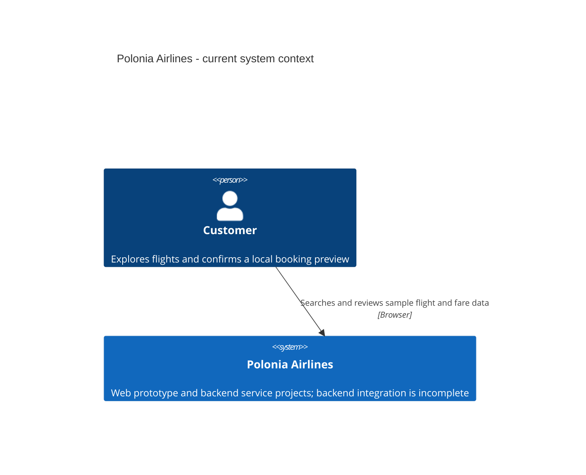
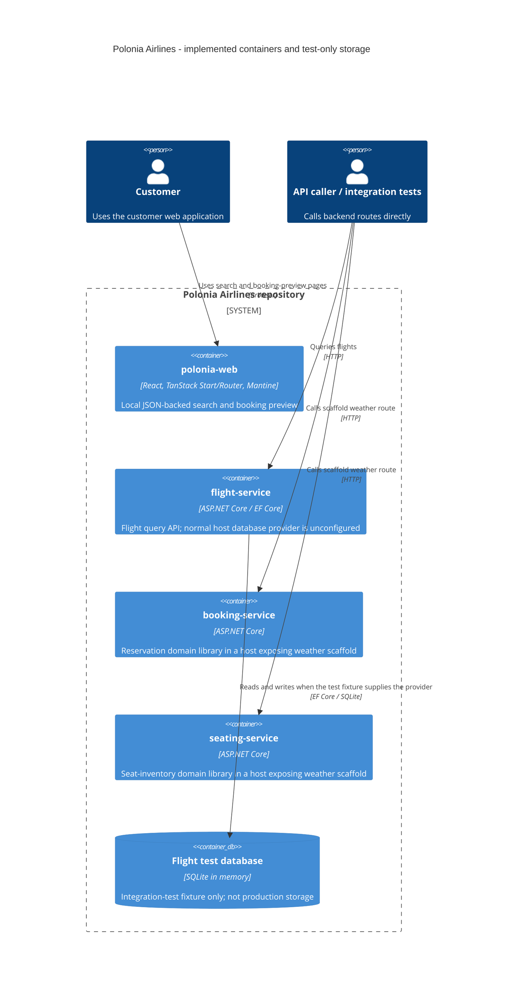
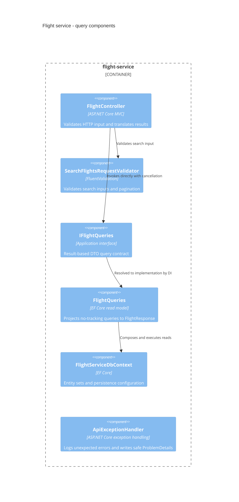

# Architecture

[Documentation index](README.md)

## Current implementation

Polonia Airlines is a full-stack airline prototype with three ASP.NET Core
service projects and one customer-facing web application.
The repository aims for DDD, Clean Architecture, and CQRS; implementation maturity
differs by service.

| Area | Implemented | Not wired or not implemented |
| --- | --- | --- |
| Web | Search, fare selection, booking preview from local JSON | Backend API client, persistent reservations, payment processing |
| Flight | Validated query endpoints, DTOs, EF model and query service | Database provider in normal startup; working aircraft queries |
| Booking | Reservation aggregate with passenger fares, baggage and recorded payments | Business endpoints, persistence and command handlers |
| Seating | Inventory and seat-assignment domain rules | Business endpoints, persistence and command handlers |
| Shared | Entity/aggregate bases, command pipelines, publisher abstraction | Host registration of shared pipelines, transport and consumers |

## C4 level 1: system context

The customer relationship represents the implemented browser experience. There
are no implemented payment-provider, identity-provider, or other airline-system
integrations to draw.

## C4 level 2: containers

These are code-level runtime boundaries, not a claim about deployed infrastructure.
The SQLite container exists only inside integration tests. The isolated service
containers have no drawn inter-service links because none are implemented.

## C4 level 3: flight-query components

The application interface and validator are implemented in `Application`, while
the concrete read model is in `Infrastructure`. This is a component view of the
flight service, not an additional deployment boundary.

Unexpected exceptions propagate to the registered exception handler; it is not
called directly by the controller. See the [flight sequence](services/flight-service.md#query-sequence).

## Layering and shared building blocks

The intended service organization is `Api`, `Application`, `Domain`, and
`Infrastructure`, defined in [repository instructions](../.github/copilot-instructions.md).
These are folders within each service project, not separate assemblies.

- `Api`: HTTP contracts, controllers, validation invocation and error translation.
- `Application`: use-case contracts, response DTOs, query abstractions and validators.
- `Domain`: entities, aggregate invariants and value objects.
- `Infrastructure`: EF mappings, concrete query services and external-system adapters.
- [Shared](../backend/shared/): reusable entity identities, aggregate domain-event
  collection, DispatchR command and validation/transaction pipelines, and the
  MassTransit-backed integration publisher.

The existing flight application registers its query validator directly. It does
not call `AddSharedApplication`; booking and seating do not wire command pipelines
either. Do not infer active mediator processing from package references.
The shared transaction pipeline requires an `IUnitOfWork` implementation.

Cross-service references use opaque strings: booking references flight IDs, and
seating references flight, cabin, reservation, passenger and optional seat IDs.
They are not cross-service foreign keys or entity navigations.

## Integration and persistence limitations

No concrete integration-event contracts, consumers, broker transport registration,
or implemented service-to-service calls were found. There is therefore no current
cross-service sequence diagram. The MassTransit publisher and domain-event
collection are building blocks, not evidence of a working outbox/inbox flow.

The flight service has EF configurations and relational integration tests, but
normal startup registers `FlightServiceDbContext` without a provider. No migrations
are checked in. Booking and seating have no configured DbContext.
Do not describe a production database, gateway, or distributed deployment as implemented.

See [development](development.md) for commands and [frontend](frontend.md) for the
separate local-data UI flow.
