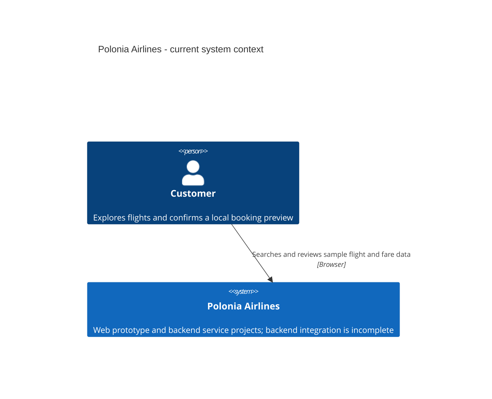
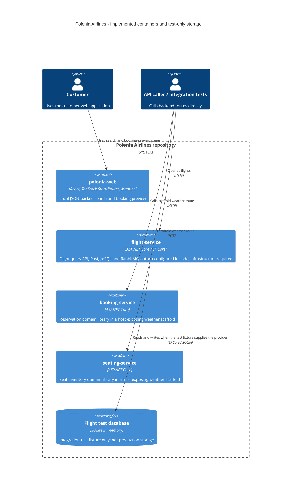
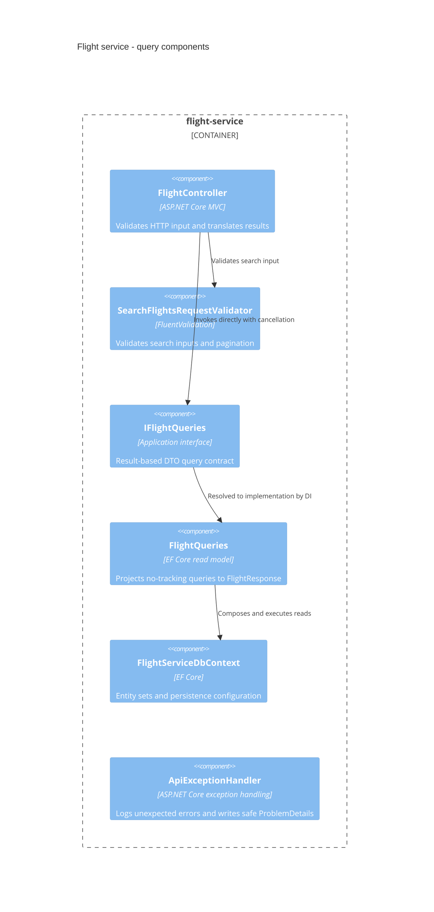

# Architecture

[Documentation index](README.md)

## Current implementation

Polonia Airlines is a full-stack airline prototype with three ASP.NET Core
service projects and one customer-facing web application.
The repository aims for DDD, Clean Architecture, and CQRS; implementation maturity
differs by service.

| Area | Implemented | Not wired or not implemented |
| --- | --- | --- |
| Web | Search, fare selection, booking preview from local JSON | Backend API client, persistent reservations, payment processing |
| Flight | Validated query endpoints, DTOs, PostgreSQL registration, RabbitMQ EF bus outbox | Schema migrations, deployed infrastructure, working aircraft queries |
| Booking | Reservation aggregate with passenger fares, baggage and recorded payments | Business endpoints, persistence and command handlers |
| Seating | Inventory and seat-assignment domain rules | Business endpoints, persistence and command handlers |
| Shared | Entity/aggregate bases, repositories, command pipelines, domain-event dispatch and EF outbox helpers | Host registration of shared command pipelines, business event handlers and consumers |

## C4 level 1: system context

The customer relationship represents the implemented browser experience. There
are no implemented payment-provider, identity-provider, or other airline-system
integrations to draw.



## C4 level 2: containers

These are code-level runtime boundaries, not a claim about deployed infrastructure.
The SQLite container exists only inside integration tests. The isolated service
containers have no drawn inter-service links because none are implemented.



## C4 level 3: flight-query components

The application interface and validator are implemented in `Application`, while
the concrete read model is in `Infrastructure`. This is a component view of the
flight service, not an additional deployment boundary.



Unexpected exceptions propagate to the registered exception handler; it is not
called directly by the controller. See the [flight sequence](services/flight-service.md#query-sequence).

## Layering and shared building blocks

The intended service organization is `Api`, `Application`, `Domain`, and
`Infrastructure`, defined in [repository instructions](../../.github/copilot-instructions.md).
These are folders within each service project, not separate assemblies.

- `Api`: HTTP contracts, controllers, validation invocation and error translation.
- `Application`: use-case contracts, response DTOs, query abstractions and validators.
- `Domain`: entities, aggregate invariants and value objects.
- `Infrastructure`: EF mappings, concrete query services and external-system adapters.
- [Shared](../../backend/shared/): reusable entity identities, aggregate domain-event
  collection, DispatchR command and validation/execution-strategy/transaction pipelines, and the
  MassTransit-backed integration publisher.

### Domain events and transactional messaging

[`EfUnitOfWork`](../../backend/shared/Infrastructure/Persistance/EfUnitOfWork.cs)
drains domain events from tracked `IHasDomainEvents` aggregates before saving.
Each batch is cleared before dispatch, so handlers can raise further events for
the next batch without redispatching the original events. Handlers run sequentially.
Register each typed application handler explicitly:

```csharp
services.AddDomainEventHandler<FlightCreated, FlightCreatedHandler>();
```

Handlers implement `IDomainEventHandler<TEvent>` and may mutate tracked aggregates
or map domain events to stable integration contracts through
`IIntegrationEventPublisher`. Domain events with no registered handler are simply
consumed; not every domain event is an integration event. Handler exceptions and
cancellation propagate to the existing transaction pipeline. Nested saves and
reuse after a failed save are rejected; discard the failed command's scope.
Direct `DbContext.SaveChangesAsync` bypasses domain-event dispatch.

Domain handlers run before database-generated IDs are available for new entities.
Use application-assigned identities for events that need an ID, or explicitly
design a transactional two-save flow rather than publishing a default ID.
Handlers must not commit, perform irreversible external I/O, or create unbounded
event cycles.

[`AddSharedEntityFrameworkOutbox<TContext>`](../../backend/shared/Infrastructure/DependencyInjection/SharedInfrastructureServiceCollectionExtensions.cs)
registers MassTransit's EF outbox with the bus outbox enabled. The caller selects
the database locking provider; flight uses `UsePostgres()`. Its context maps
`InboxState`, `OutboxMessage`, and `OutboxState`. Scoped `IPublishEndpoint` calls
are captured as outbox rows, saved with business changes, and sent to RabbitMQ
by MassTransit's delivery service only after commit. Use the scoped publisher,
not `IBus.Publish`, which bypasses this scope's outbox.

This is at-least-once delivery, not exactly-once processing. No consumers are
currently registered. Future consumers must explicitly configure
`UseEntityFrameworkOutbox<TContext>(context)` on their receive endpoints and
implement appropriate business idempotency; mapping inbox tables alone does not
enable consumer deduplication.

The existing flight application registers its query validator directly. It does
not call `AddSharedApplication`; booking and seating do not wire command pipelines
either. Do not infer active mediator processing from package references.
The shared transaction pipeline applies only to commands implementing
[`ITransactionalCommand<TCommand, TResponse>`](../../backend/shared/Application/Commands/ITransactionalCommand.cs).
Ordinary `ICommand` handlers still receive validation but own their orchestration
and persistence boundaries; they do not require an `IUnitOfWork` registration.

Services can register the shared EF implementation alongside their scoped context:

```csharp
services.AddDbContext<ServiceDbContext>(options => /* configure provider */);
services.AddSharedUnitOfWork<ServiceDbContext>();
services.AddSharedApplication(typeof(ApplicationAssemblyMarker).Assembly);
```

Command-side aggregate repositories can implement
[`IRepository<TAggregate, TId>`](../../backend/shared/Application/Abstractions/IRepository.cs)
by inheriting
[`RepositoryBase<TAggregate, TId>`](../../backend/shared/Infrastructure/Repositories/RepositoryBase.cs).
The base supports tracked ID lookup, `Add`, `Remove`, `AddRange`, and `RemoveRange`
for aggregate roots. It never saves changes. Use the same scoped context as the
Unit of Work, and register concrete repositories against their application interfaces.
The airport repository uses this base while retaining its IATA lookup.

The default ID lookup uses EF's `FindAsync`: it returns a tracked instance when
available and does not explicitly load child collections. Override it when an
aggregate requires related state. Existing tracked aggregates are changed through
domain methods without calling `Update`. Range operations use change tracking;
they are not immediate bulk SQL operations. Read-only projections remain in query
services rather than the generic repository.

`AddSharedUnitOfWork` is in `Shared.Infrastructure.DependencyInjection` and
registers both `IUnitOfWork` and the EF-backed `ICommandExecutionStrategy`.
The context and repositories must share the same scope. For example, a command
declares `ITransactionalCommand<CreateFlightCommand, Result>` instead of
`ICommand<CreateFlightCommand, Result>` to opt in. Its handler changes tracked
entities; the pipeline saves and commits successful responses and rolls back
failed FluentResults responses, exceptions, or cancellation. Rollback uses an
uncancelled token. If both execution and rollback throw, both exceptions surface
in an `AggregateException`. Transactions are disposed after commit or rollback;
nested transactions are rejected. A rollback does not reset tracked entities:
end the failed command's scope rather than reusing its context.

Transaction opt-in alone does **not** enable handler retries.
[`IRetryableCommand<TCommand, TResponse>`](../../backend/shared/Application/Commands/IRetryableCommand.cs)
opts into both transactions and replay of the entire command via EF Core's
provider execution strategy:

```csharp
public sealed record CreateFlightCommand(/* immutable inputs */)
    : IRetryableCommand<CreateFlightCommand, Result>;
```

The pipeline order is validation, execution strategy, then transaction. Each
attempt redispatches the same command in a fresh async DI scope, giving it a new
handler, scoped dependencies, DbContext, and transaction; validation also runs
inside each attempt. Attempt scopes are disposed before retrying. The caller's
tracked entities and initialized scoped state are not transferred into these
scopes: provide required inputs through the command or independently resolvable
dependencies. Commands must be immutable/replay-safe, return detached response
DTOs rather than entities or deferred queries, and must not manually commit.

`EfCommandExecutionStrategy<TContext>` calls
`Database.CreateExecutionStrategy()`. Each service must configure the provider's
retry policy (for example, SQL Server's `EnableRetryOnFailure`); the default
non-retrying strategy still executes once. Only provider-classified transient
exceptions before commit, with successful rollback where a transaction began,
are eligible for retry. Retry limits and delays are controlled by the provider,
not a second Polly policy. Transaction-only commands do not invoke this wrapper;
a provider requiring an execution-strategy boundary for explicit transactions
cannot be used with that path without an explicit service-level design.

Failed FluentResults responses, validation failures, cancellation, and rollback
failures are never replayed. Any exception once commit is attempted is rethrown
outside the strategy's retry loop, even if it looks transient: the commit may
already have succeeded. Such errors require reconciliation or durable
idempotency/success verification before a caller retries; no generic commit
verification is claimed here. Successful database commit followed by disposal
failure is likewise not replayed.

Nested command transactions and retry boundaries inside active command
transactions are rejected. Use one top-level command boundary and compose
application/domain operations inside it, rather than nesting opted-in commands.

For database plus blob/API workflows, keep orchestration and compensation
explicit rather than opting into automatic database rollback as a distributed
transaction. Flight has initial RabbitMQ bus-outbox registration; saga
coordination, consumer inbox middleware, and business idempotency are not wired.
Kafka rider and Service Bus delivery paths must be verified separately for outbox support.

Cross-service references use opaque strings: booking references flight IDs, and
seating references flight, cabin, reservation, passenger and optional seat IDs.
They are not cross-service foreign keys or entity navigations.

## Integration and persistence limitations

No production integration-event contracts, domain-event mappings, consumers,
or implemented service-to-service calls are wired. There is therefore no current
cross-service sequence diagram. Tests verify domain-event dispatch and atomic
business/outbox persistence with SQLite and an unstarted in-memory bus, not live
PostgreSQL-to-RabbitMQ delivery.

The flight service has EF configurations and relational integration tests, but
normal startup now selects PostgreSQL and requires external database and RabbitMQ
configuration. No migrations are checked in; schema creation and deployment
remain prerequisites. Booking and seating have no configured DbContext.
Do not describe a production database, gateway, or distributed deployment as implemented.

See [development](development.md) for commands and [frontend](frontend.md) for the
separate local-data UI flow.
