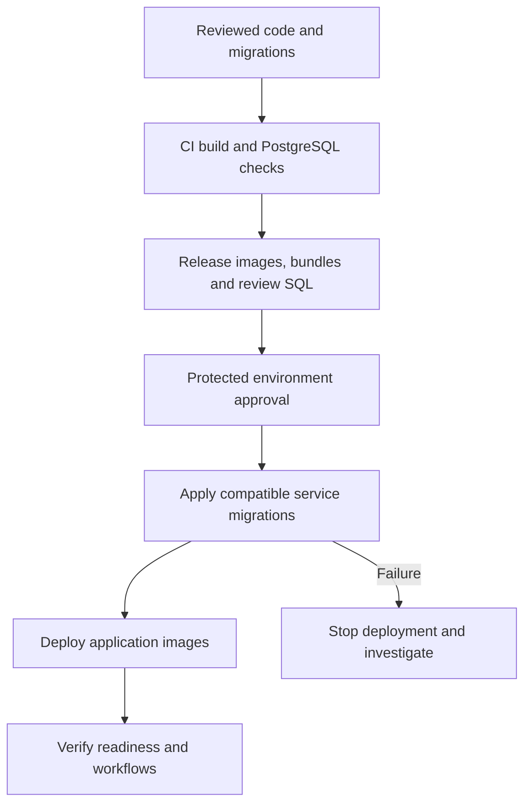

# EF Core migrations and database deployment

[Documentation index](README.md)

## Status and decision

Use EF Core as the schema-management tool, with reviewed, service-owned migrations
applied automatically by CI/CD deployment jobs. This is the agreed target design,
not an implemented deployment pipeline.

The three services have initial PostgreSQL migrations, model snapshots, and
design-time context factories. The root `dotnet-tools.json` pins dotnet-ef 10.0.14,
matching the centrally managed EF Core Design package. Hosts do not create or migrate schemas.
The [CI workflow](../../.github/workflows/ci.yml) builds and tests applications;
it does not deploy databases. [Compose](../../compose.yaml) initializes separate
empty databases, not application tables.

The [booking/seating broker tests](../../backend/tests/integration/booking-service.integration.test/ReservationBrokerWorkflowTests.cs)
apply checked-in migrations to fresh isolated PostgreSQL databases before starting
the production hosts. CI now supplies their infrastructure; both scenarios passed
locally. This provides fresh-schema coverage for booking/seating, not the full
three-service migration matrix, model-drift checks, upgrade tests or deployment
jobs described below.

## Ownership and migration authoring

| Service | DbContext | Connection setting |
| --- | --- | --- |
| Flight | FlightServiceDbContext | ConnectionStrings:FlightDatabase |
| Booking | BookingDbContext | ConnectionStrings:BookingDatabase |
| Seating | SeatingDbContext | ConnectionStrings:SeatingDatabase |

Each service owns its database, migrations, and model snapshot. Store migrations
under its `Infrastructure/Persistence/Migrations` directory. Do not share a
cross-service migration history or introduce cross-service foreign keys.

Development workflow:

1. Change a service's EF model or mapping.
2. Generate a meaningfully named migration with pinned EF Core tooling.
3. Review the migration, snapshot, and generated PostgreSQL SQL.
4. Add explicit data transformations where needed; EF cannot reliably distinguish
   a rename from dropping and recreating a column.
5. Validate and commit the migration with the application change.

Migration generation is a development activity, never an automatic production
deployment step. Use [the migration skill](../../.github/skills/ef-core-migrations/SKILL.md)
to guide creation and review; it does not replace deterministic CI checks.

The repository-local `dotnet-ef` manifest and centrally managed
`Microsoft.EntityFrameworkCore.Design` development references are aligned with the
project's EF Core version. Design-time factories construct only the target
DbContext with Npgsql, without starting HTTP hosts, RabbitMQ, Redis, or consumers.
Never embed real connection strings or credentials in generated files.

Initial migrations must include service entities and their constraints, MassTransit
inbox/outbox mappings, booking saga state, and seating's configured mutation-guard
seed row. Business catalog, aircraft, cabin, and seat provisioning is separate
from general schema creation.

An existing database created without migrations requires explicit schema comparison
and a reviewed baseline/backfill plan. Do not blindly apply an initial migration,
delete the database, or fabricate migration-history rows to make it appear compatible.

## Pull-request CI

Use a matrix of the three service/context pairs rather than maintaining three
independent handwritten workflows. For each pair:

- Build and check `dotnet ef migrations has-pending-model-changes`.
- Apply the committed migrations to a fresh, isolated PostgreSQL database.
- Verify a second application has no pending migrations.
- Create the previous released schema, populate representative fixtures, and
  apply the new release's migrations. Verify preserved data and required constraints.
  For the first release, the empty-to-initial-schema path is the baseline.
- Run relevant PostgreSQL integration tests, including provider-specific
  saga/outbox persistence. SQLite and `EnsureCreated` tests do not validate migrations.

Failures block the PR. Use disposable databases and local test credentials, not
deployed databases. Migration SQL review is still needed even when tests pass.

## Current local migration commands

Restore tooling and dependencies from the repository root:

```powershell
dotnet tool restore
dotnet restore polonia-airlines.slnx
```

Factories require the corresponding `ConnectionStrings__FlightDatabase`,
`ConnectionStrings__BookingDatabase`, or `ConnectionStrings__SeatingDatabase`
environment variable. They do not read `.env`, appsettings, or user secrets
automatically. Supply the approved target connection securely; do not put
credentials in tracked scripts or command history.

For example, after configuring `ConnectionStrings__BookingDatabase` for an
empty, dedicated local database:

```powershell
$project = 'backend\booking-service\booking-service.csproj'
dotnet ef migrations has-pending-model-changes --project $project
dotnet ef migrations script 0 InitialCreate --project $project --output <ReviewSqlPath>
dotnet ef database update --project $project
```

Select the corresponding project for flight or seating. `database update`
applies committed migrations; repeating it is a no-op when already current.
Do not use these initial migrations as an upgrade for an existing unbaselined
database. The initial `Down` operations drop service tables and data.

## Release and deployment

Build one EF migration bundle per service with each release and publish generated
SQL for review. Match bundle runtime/architecture to the deployment runner. Record
the commit and artifact identity with application images; promote the same tested
artifacts across environments rather than rebuilding against live schemas.



Deployment runs bundles with environment-scoped schema-changing credentials.
Normal application accounts should not have DDL permissions. EF's migration-history
table records which migrations were applied; deployment executes the bundle for each
service rather than requiring a person to select updates manually.

Serialize deployments to each environment. EF provider migration locking is an
additional safeguard, not a replacement for deployment concurrency control.
Do not cancel a running migration merely because a newer release was queued.
Ensure the deployment runner can reach the databases through the intended private
network; do not expose PostgreSQL publicly just to make GitHub Actions reach it.

A failed migration prevents application rollout. Inspect partially applied work,
especially nontransactional operations, before retrying. Separate databases cannot
migrate atomically: if flight succeeds and booking fails, flight's schema remains
updated. Compatible migrations must allow the old release to continue operating.

## Compatibility and recovery

- No schema updates on application startup: replicas and broker consumers must
  not race to migrate.
- Use expand/contract releases: add compatible structures, deploy compatible
  code, backfill data, then remove obsolete structures in a later release.
- Consider both old application instances and delayed broker messages/consumers.
- Review locks, table rewrites, long backfills, and nontransactional PostgreSQL
  operations before deployment. Large backfills may need separately resumable jobs.
- Do not automatically run `Down()` after a failed rollout. Prefer a corrective
  forward migration; use tested backups/restores only under a deliberate recovery plan.
- Restoring a database while broker/outbox state has advanced needs coordinated
  recovery and duplicate handling, not just a schema rollback.
- Listener health alone is insufficient: verify schema version, database/broker
  access, and relevant service behavior after rollout.

## Local Compose

Use one-shot migration containers built from the same bundle artifacts. Each
application should depend on successful completion of its migration container,
which in turn waits for PostgreSQL health. Failure must leave the application
unstarted rather than silently continuing.

This remains planned work: current Compose does not contain migration containers.
Local development can build bundles from the current checkout; deployed environments
must use immutable release artifacts. Infrastructure credentials, schema credentials,
and normal service credentials should remain distinct.

## Implementation order and open decisions

1. Completed: pinned tooling, design-time factories, and initial migrations,
   validated on disposable PostgreSQL 18 databases.
2. Add fresh-database and previous-release upgrade checks against PostgreSQL.
3. Build migration bundles and integrate local one-shot Compose jobs.
4. Wire protected deployment jobs to the selected hosting platform.

Still to decide: hosting platform and runner network access, environment/approval
rules, release-baseline artifact retention, credential provisioning, backup/recovery
requirements, and whether existing databases need a baseline migration.

## EF Core references

- [Managing migrations](https://learn.microsoft.com/en-us/ef/core/managing-schemas/migrations/managing)
- [Applying migrations and bundles](https://learn.microsoft.com/en-us/ef/core/managing-schemas/migrations/applying)
- [Design-time DbContext creation](https://learn.microsoft.com/en-us/ef/core/cli/dbcontext-creation)
