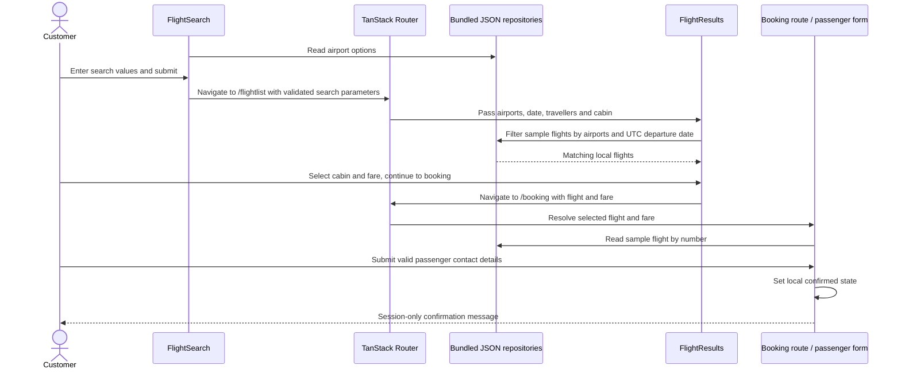

# Customer web application

[Documentation index](README.md) | [Architecture](architecture.md)

## Platform and routes

[polonia-web](../../frontend/polonia-web/) uses React, TypeScript, TanStack Start
and file-based TanStack Router routes, Mantine components/forms, and Vite.
The root document supplies the application shell, theme initialization and devtools.
Desktop and native mobile applications are not present.

| Route | Current feature |
| --- | --- |
| `/` | Hero, flight-search panel, service highlights and destination cards; prefills from search parameters |
| `/flightlist` | Booking progress, search recap, date fare strip, sortable flight cards with cabin/fare selection and a journey summary |
| `/booking` | Selected flight/fare summary and passenger contact form (not yet redesigned) |
| `/about` | Starter informational page |

## Visual design

Search and results follow the October 2026 Figma booking-flow designs, adapted to
Polonia Airlines branding: deep red `#A51D35`, gold accent `#AC8A51`, warm neutral
surfaces, Lora display headings and Inter body text. Fonts are self-hosted through
`@fontsource` packages. Tokens live in
[_variables.scss](../../frontend/polonia-web/src/styles/abstracts/_variables.scss) and
[global.scss](../../frontend/polonia-web/src/styles/global.scss) with light and dark
values; the Mantine theme is in [theme.ts](../../frontend/polonia-web/src/app/theme.ts).
Icons use `lucide-react`. Hero and destination photography are neutral placeholders
until licensed Polonia images are supplied. Layouts are responsive down to mobile
widths. Passenger details, payment and confirmation designs are not implemented yet.

## Data and behavior

[Airport repository](../../frontend/polonia-web/src/entities/airport/airport.repository.ts)
loads bundled airport JSON for select options, city names and code lookup.
[Flight repository](../../frontend/polonia-web/src/features/flight-results/data/flight.repository.ts)
loads bundled sample flight JSON (two Chicago–Kraków outbound flights) and filters
by departure and arrival airport. There is no backend fetch/API client yet.

The search form collects airports (with swap), a departure/return date range or
single date, trip type, traveller counts and cabin preference. Search parameters are
validated by
[search-params.ts](../../frontend/polonia-web/src/features/flight-search/model/search-params.ts)
and shared by `/` and `/flightlist`; invalid values fall back to defaults.
Manage booking, check-in, flight status and multi-city are shown as disabled.

Results filter by the selected departure UTC calendar date (or the earliest
available date when none is given). The date strip shows the lowest fare per day
for ±2 days; empty dates offer the nearest available date. Schedule times are the
sample data's UTC values. Fares are shown per adult in USD; the summary multiplies
the chosen fare by adults and children, and infant pricing is deferred to booking.
No taxes, return flights or availability are invented: round trips show that return
flights are not in the current schedule. Continue passes the flight number and fare
ID to `/booking`.

Booking resolves the selected flight number and numeric fare ID from local data.
Missing selections show a "Choose a flight first" prompt.
The contact form validates first name, last name and email. Confirmation only
sets React component state: it does not persist a reservation, contact the booking
service, allocate a seat or process payment.

## Search-to-confirmation sequence

This is deliberately separate from the backend query and domain sequences.
Connecting it to real availability, booking and payment requires new implementation.

## Development

See [development commands](development.md). Production builds and the search and
results flows were checked in Edge at desktop and mobile widths in light and dark
themes; this is not an accessibility certification.
[vite.config.ts](../../frontend/polonia-web/vite.config.ts) disables TanStack devtools
console piping, which re-logged errors between browser and dev server in a growing
loop, and skips devtools source annotations for `__root.tsx`, whose server and client
line numbers differed and caused hydration mismatches.
