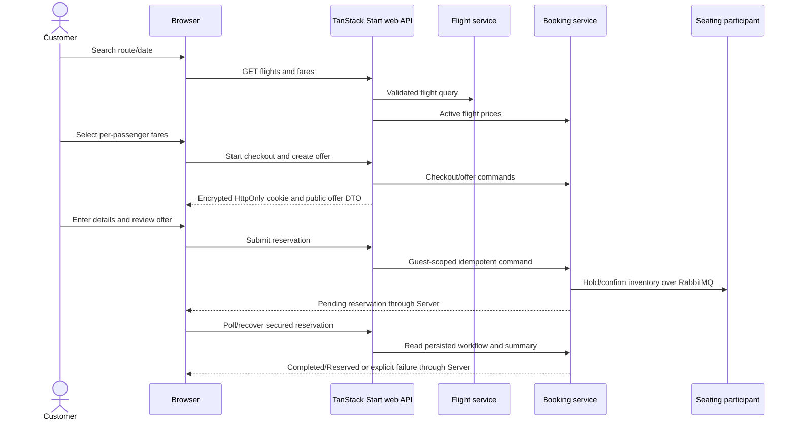

# Customer web application

[Documentation index](README.md) | [Architecture](architecture.md)

## Platform and routes

[polonia-web](../../frontend/polonia-web/) uses React, TypeScript, TanStack Start
and file-based TanStack Router routes, Mantine components/forms, and Vite.
Desktop and native mobile applications are not present.

| Route | Current feature |
| --- | --- |
| `/` | One-way flight search, airport swap, traveller counts and editorial destination inspiration |
| `/flightlist` | Real paginated flight search (page in the URL), current USD fares, cabin/fare choice with baggage terms and per-passenger fare selection |
| `/booking?offer=...` | Guest offer, passenger details, review, reservation submission, workflow polling and stored PNR summary |
| `/api/web/*` | Server-only customer API layer; explicitly allowlisted reads and guest checkout operations |

## Scope and data

The first integration supports one selected flight and up to eight seated travellers
aged two or older. Return journeys, connection selection and infant bookings are
disabled; unsupported stale URL parameters show an explicit unsupported-journey
state. Children use the selected product's price: there is no age-based discount.
Manage booking, check-in, flight status and multi-city remain disabled.

[Airport labels](../../frontend/polonia-web/src/entities/airport/airport.repository.ts)
remain bundled reference data, not a promise that a route is operated.
The current booking routes no longer use sample flight JSON or demo PNRs.
Editorial destination cards show no sample prices.

[Typed API clients](../../frontend/polonia-web/src/shared/api/client.ts) validate
response shapes and call the same-origin server layer. Flight search uses exact
IATA codes, a required UTC calendar date and 20-result pages. Fare discovery batches
that page's canonical flight references against booking's actual active prices.
Flight IDs and product UUIDs identify selections; flight numbers are display labels.
Empty flights/prices and backend failures are explicit, with no sample-data fallback.

Flight DTOs do not expose aircraft descriptions or timed connection details, and
fare products do not expose the prototype's lounge, meal, change/refund claims.
The integrated screens omit these claims rather than inventing data: the results
timeline shows only UTC times, airports, duration and flight number, and the date
strip navigates to nearby dates without showing their prices. Cabin/brand labels,
baggage limits, currency and amounts come from actual product/offer responses.
A priced fare is not guaranteed availability.

## Guest session and reservation lifecycle

[The web API layer](../../frontend/polonia-web/src/server/web-api/handler.server.ts)
dispatches an explicit [route allowlist](../../frontend/polonia-web/src/server/web-api/routes.server.ts) and
uses `iron-session` to encrypt the backend guest token in a one-day HttpOnly,
SameSite=Strict cookie. HTTPS origins use Secure cookies; HTTP is accepted only for
localhost/127.0.0.1 development. All mutations require the configured exact Origin
as a CSRF defense. No guest token is returned to browser JavaScript, put in a URL,
or stored in local/session storage. The echoed reservation token is stripped.
All API responses use `Cache-Control: no-store`; JSON mutation bodies are limited
to 16,384 encoded bytes. Administrative backend routes are not proxied.

Checkout creation precedes an authoritative offer. Offers expire after 15 minutes;
the review screen displays its returned price/baggage snapshots and expiry.
An expired offer cannot be submitted from the review screen. A replacement offer
requires a new selection and review.

Only first/last name and date of birth are collected for each passenger, plus
contact name/email. Unsupported travel-document, membership, phone, SMS and
special-request inputs are not shown. Draft details live in component state,
not URLs or browser persistence; a refresh before submission requires re-entry.

Submission uses a stable `web-{offerId}` request identity using the GUID contract's
canonical lowercase representation. Before submission and on
refresh, a guest-scoped request lookup recovers any committed reservation after an
ambiguous response. Retrying the same payload is safe; changed payloads conflict.
Lookup failure is not treated as absence unless it is an actual 404.

The UI polls with bounded increasing delays and cancellation:

- Pending/AwaitingCapacity/ConfirmingAllocations are not confirmation.
- Compensating means capacity release is still in progress.
- RequiresIntervention instructs the user not to create a replacement booking
  while release is unresolved, and supports explicit status refresh.
- Only `Reserved` plus `Completed` shows confirmation.
- Cancelled is a failed booking; network/poll timeout does not imply cancellation.

Reservation reads include stored passenger names, contact and the real PNR, so
confirmation survives refresh within the guest session. Itinerary details are
queried separately from flight-service; itinerary-read failures do not turn a
confirmed reservation into a failed reservation.

Payment UI is replaced with review and "Reserve without payment". No payment,
ticket issuance or confirmation email is claimed.

## Code structure

Agent and contributor rules are in the
[frontend instructions](../../.github/instructions/frontend.instructions.md).

| Folder | Responsibility |
| --- | --- |
| `src/routes` | Thin file routes: search validation and one feature page each |
| `src/app` | Shell, layouts, theme and the router-scoped TanStack Query client |
| `src/features` | `flight-search`, `flight-results`, `booking`, `home`; each exposes `index.ts`, with `model/` hooks and `ui/` components plus colocated SCSS modules |
| `src/entities` | Airport, flight, fare, offer and reservation view models, mappers, rules and shared `queryOptions` |
| `src/shared` | Typed `/api/web` client, contracts and guards; formatting and identifier helpers; UI primitives; test helpers |
| `src/server/web-api` | Server-only route allowlist, guest session, upstream client and request validation |

ESLint enforces downward imports (routes → app/features → entities → shared),
feature public APIs and `import/no-cycle`. Server state uses TanStack Query in the
browser. Reservation submission never retries automatically and recovers through
its idempotent request identity. Reservation status polls with bounded backoff until
a terminal workflow state; `deriveReservationView` maps stored status to the shown
state. First loads show section skeletons after a short delay, result paging keeps
the previous page visible while updating, and submissions use button loading states.

## Development and verification

See [development setup](development.md) for server-only environment variables and
infrastructure/data prerequisites. Existing Nginx already proxies the web app;
the API layer runs in that web server, so no browser CORS or Vite backend proxy is
required.

Focused web API/client tests cover encrypted cookies, CSRF, capability isolation,
idempotent identities, response validation, unsupported scope and safe failures.
Browser success, cancellation and refresh were checked with an isolated mock API
fixture, including a 390-pixel viewport; these are not live inventory checks.
After Docker became available, five live inventory tests and five booking
broker-workflow/crash-recovery tests passed against disposable PostgreSQL, Redis
and RabbitMQ containers. These exercise backend hosts, not the browser or
flight-service. A [full system-test harness](../../tests/system/README.md) has been
added, but its web-to-PostgreSQL/Redis/RabbitMQ scenarios have not yet been run.

The existing Polonia theme, fonts and responsive layout shell are retained.
[Vite configuration](../../frontend/polonia-web/vite.config.ts) still prevents the
previous devtools console-piping and root hydration annotation problems.
