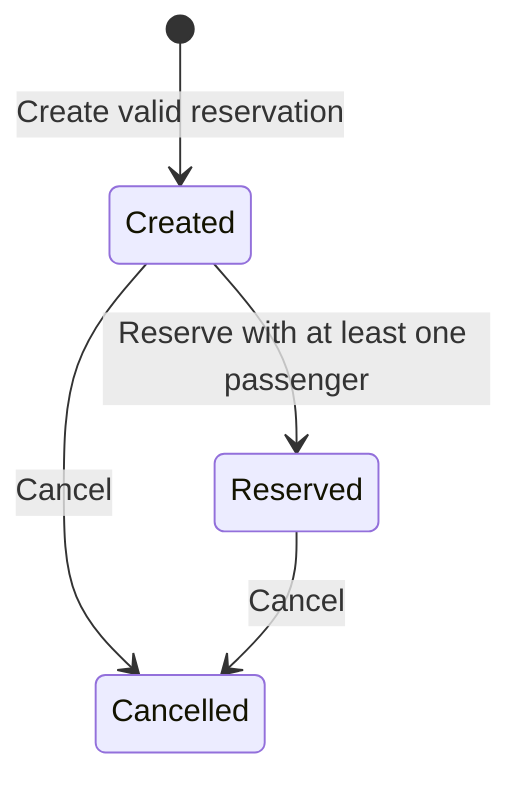
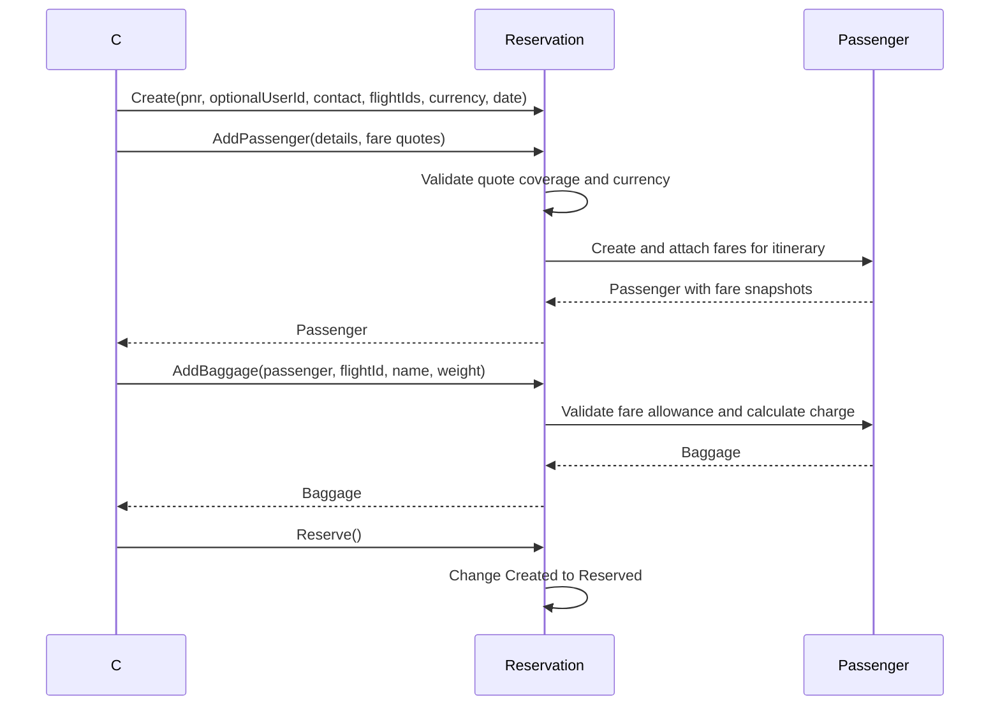

# Booking service

[Documentation index](../README.md) | [Architecture](../architecture.md)

## Implementation status

The host wires booking's API, application, and infrastructure layers. Pricing stays
inside booking: fare products are separate from flight-specific prices, expiring
offers, and purchased fare snapshots. Reservation creation starts a booking-owned
MassTransit saga. PostgreSQL, RabbitMQ, and the seating participant are required
for the distributed workflow. The sample-data web application is not connected
to it; payment-provider integration is deferred.

See the [service README](../../../backend/booking-service/README.md) for API,
configuration, schema initialization, catalog provisioning, and access-token details.
Implementation in code is not a claim that infrastructure has been deployed or
that live cross-store integration tests have passed.

## Reservation aggregate

[Reservation](../../../backend/booking-service/Domain/Entities/Reservation.cs) owns
ordered itinerary entries, passengers and payments.

- Creation requires a validated `PnrCode`, booking contact name/email, reservation date and
  a nonempty itinerary of distinct nonblank flight IDs.
- A service-owned user ID is optional for guest checkout; if supplied it must be
  positive. Public guest creation does not trust a caller-supplied account identity.
- External flight IDs retain their representation and use ordinal, case-sensitive
  uniqueness. PNRs contain six uppercase ASCII letters/digits; the application
  generates candidates and persistence enforces uniqueness. Currency follows currency-code validation.
- Each passenger requires exactly one fare quote per itinerary flight with the
  reservation currency. Quotes snapshot product, cabin, amount and baggage allowance.
- Passenger dates cannot be missing or after the reservation date.
- Baggage belongs to a passenger's fare for a specific flight. Allowances govern
  included pieces, extra pieces, per-piece weight limits and extra-piece charges.
- Total amount is derived from passenger fares and baggage charges.
- Recorded payments require positive amounts, matching currency, unique references
  and cannot exceed the current reservation total. Recording a payment is not
  payment authorization or capture.

### State transitions

Passengers and baggage can be edited only while the reservation is `Created`.
Reservation requires at least one passenger. Cancellation is allowed from
`Created` or `Reserved`; cancelling an already cancelled reservation fails.
Payments can be recorded while created or reserved, but not cancelled.

## Local domain flow

This is an in-process sequence, not an HTTP or cross-service booking workflow.

## References and gaps

Other domain types include `ReservationFlight`, `Passenger`, `PassengerFare`,
`Baggage`, `Payment`, `User`, `FareQuote`, `BaggageAllowance` and `ReservationStatus`.
Foreign service IDs are references only; they do not query the flight or seating service.
The application publishes `ReservationRequested` through the EF bus outbox after
creating the reservation and consuming its server-priced offer in one local
transaction. The saga exchanges hold, confirmation, and release messages with
seating; it does not replace the reservation aggregate.

## Distributed completion

- Offers expire after 15 minutes; inventory holds expire after 10 minutes.
- The saga progresses through `AwaitingCapacity`, `ConfirmingAllocations`, and
  `Completed`. Only confirmed inventory causes the aggregate to become `Reserved`.
- Failures and timeouts enter `Compensating`. The reservation is cancelled only
  after seating acknowledges release.
- Compensation is retried and escalates to `RequiresIntervention` after 30 minutes;
  release attempts continue. Operators must inspect logs, workflow status, and
  MassTransit error queues rather than treating escalation as a successful cancellation.
- A persistent deadline poller publishes timeout messages through the outbox;
  deadlines survive application restarts without a RabbitMQ scheduling plugin.
- Terminal saga records are retained so duplicate starts and late replies cannot
  recreate completed work. Payment is not part of this first-release workflow.

Unit and integration test sources cover catalog/offer rules, reservation
idempotency, domain invariants, and saga transitions. Execution of tests for this
implementation was explicitly deferred by the user.
