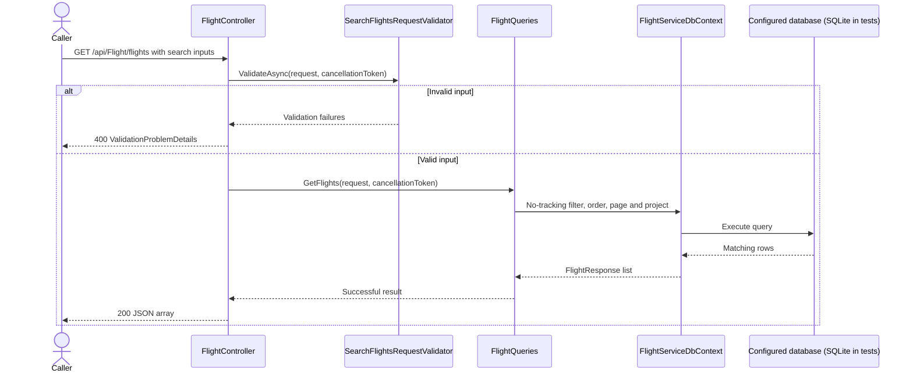

# Flight service

[Documentation index](../README.md) | [Architecture](../architecture.md)

## Runtime and API

[Program.cs](../../../backend/flight-service/Program.cs) chains per-layer
`AddApi`, `AddApplication`, and `AddInfrastructure` registration. It enables
exception handling, status-code pages, HTTPS redirection, authorization middleware,
controllers, and development-only OpenAPI at `/openapi/v1.json`.
No authentication scheme or authorization requirement is configured on these controllers.

| Method | Path | Current behavior |
| --- | --- | --- |
| GET | `/api/Flight/flights` | Validated, paginated flight search |
| GET | `/api/Flight/flight/{flightId}` | Single-flight query with positive integer ID |
| GET | `/api/Aircraft/aircrafts` | Placeholder: returns empty `200 OK`; does not query aircraft |
| GET | `/api/Aircraft/aircraft/{aircraftId}` | Placeholder: returns empty `200 OK` |

[AirportController](../../../backend/flight-service/Api/Controllers/AirportController.cs)
has no actions, so it exposes no airport query endpoint.

### Search and response contract

Search uses [SearchFlightsRequest](../../../backend/flight-service/Application/Contracts/Requests/SearchFlightsRequest.cs):

- `DepartureAirport` and `ArrivalAirport`: required exact uppercase three-letter
  IATA codes, without trimming or normalization.
- `DepartureDate`: required date, less than `DateOnly.MaxValue`.
- `Page`: defaults to 1 and must be positive.
- `PageSize`: defaults to 20 and must be 1 through 100.
- Pagination rejects offsets beyond the supported integer range.

Example: `GET /api/Flight/flights?DepartureAirport=WAW&ArrivalAirport=KRK&DepartureDate=2026-10-13&Page=1&PageSize=20`.

The response is a JSON array, not a pagination envelope.
[FlightResponse](../../../backend/flight-service/Application/Contracts/Responses/FlightResponse.cs)
contains `id`, `flightNumber`, `departureTime`, `arrivalTime`, `departureAirport`
and `arrivalAirport`. Time values are projected with explicit UTC offsets.
The single-flight endpoint returns one DTO of the same shape.

### Outcomes

- Search with no matches: `200` and an empty array.
- Invalid search or route input: `400` validation problem details.
- Missing single flight: `404` problem details with code `flight_not_found`.
- Unexpected failures: `500` safe problem details with a trace identifier; full
  exceptions are logged internally. Unrecognized query failures are not treated
  as successful responses.

## Query sequence

Queries call [IFlightQueries](../../../backend/flight-service/Application/Features/FlightFeatures/Queries/IFlightQueries.cs)
directly, not mediator handlers. Normal startup selects PostgreSQL;
the integration-test fixture replaces it with SQLite.



## Domain and persistence

The domain includes flights and ordered segments, schedules with operating days,
airports and gates, aircraft and types, and aircraft configurations with passenger
seat maps. Aggregate methods control child collection changes.

### Aircraft configuration and seat-map ownership

[`AircraftConfiguration`](../../../backend/flight-service/Domain/Entities/AircraftConfiguration.cs)
remains the aggregate root. Its factory creates one
[`SeatMap`](../../../backend/flight-service/Domain/Entities/SeatMap.cs) child entity;
maps have no independent creation workflow, version, or repository. Multiple
aircraft may reference the same configuration, but different configurations do not
share a seat map. Rows now reference a map rather than the configuration directly:

```text
Aircraft -> AircraftConfiguration -> SeatMap -> SeatMapRows -> SeatMapPositions
```

Create rows with `SeatMapRow.Create(configuration.SeatMap, cabin, rowType)` and
add them with `configuration.SeatMap.AddRow(row)`. The map exposes its rows as a
read-only collection and rejects duplicate additions and rows from another map.
Cabins remain referenced descriptive entities rather than children deleted with a map.
Load `SeatMap` and its rows/positions explicitly when editing the aggregate;
there is no automatic eager loading.

Domain ownership is mapped as a required one-to-one relationship in separate
`SeatMaps` storage, not EF `OwnsOne`. A unique configuration foreign key prevents
multiple maps for one configuration. Deleting an unreferenced configuration
cascades through its map, rows, and positions; referenced configurations still
cannot be deleted while aircraft use them.

This changes the schema: add `SeatMaps` with `AircraftConfigurationId`, and move
the row foreign key from `AircraftConfigurationId` to `SeatMapId`. No migrations
are currently supplied in the repository. Existing databases need a reviewed
migration that creates one map per configuration and backfills row references
before dropping the old foreign key/column; `EnsureCreated` does not upgrade them.
Cargo layouts, independent seat-map publishing, and new versioning rules remain
deferred.

### Schedule operating days

Schedule operating days use the `OperatingDays` value object with
`FromDays(IEnumerable<DayOfWeek>)` and `HasDay(DayOfWeek)`. Construction requires
at least one valid day; duplicates are collapsed. Persistence retains the existing
integer bitmask (Monday = 1 through Sunday = 64), not `DayOfWeek` enum numbers.
`FromValue` supports valid stored masks including the `None` sentinel; schedules
reject `None`. The schedule command accepts a typed day collection and validates
nonempty input and defined enum values.

The [Schedule](../../../backend/flight-service/Domain/Entities/Schedule.cs) aggregate
is exposed through `FlightServiceDbContext.Schedules`. Its EF mapping retains
the `FlightSchedules` table name for storage compatibility.
The create command, handler, and validator live under
[ScheduleFeatures/Commands/CreateSchedule](../../../backend/flight-service/Application/Features/ScheduleFeatures/Commands/CreateSchedule/).

### Queries and infrastructure

[FlightQueries](../../../backend/flight-service/Infrastructure/Persistence/Queries/FlightQueries.cs)
filters departure times using UTC day boundaries and orders by departure time
then ID before pagination. EF projections avoid serializing domain entities.
Single reads discover absence during the read and return `FlightNotFoundError`.

[FlightServiceDbContext](../../../backend/flight-service/Infrastructure/Persistence/FlightServiceDbContext.cs)
loads mappings from its persistence configuration namespace and maps MassTransit's
inbox/outbox tables. Normal startup selects PostgreSQL using
`ConnectionStrings:FlightDatabase` and registers RabbitMQ with an EF bus outbox.
See [development setup](../development.md#prerequisites-and-local-startup) for
required settings and schema prerequisites. No migrations or seed data are supplied.
An unconfigured database read produces a safe server error, not sample data.

## Commands, events and verification

No flight command handlers, concrete integration events, consumers, or
cross-service flows are currently wired.
The aircraft controller has an unused mediator constructor parameter, not an
implemented command/query path.

Tests cover input validation, aggregate collection ownership, EF relationships,
query ordering and UTC date boundaries, result mapping, safe exception responses
and OpenAPI response metadata. Infrastructure tests verify PostgreSQL model/schema
generation without opening a connection. Shared tests exercise domain-event
dispatch and outbox persistence/rollback without a live broker.
See [development checks](../development.md#verification).
