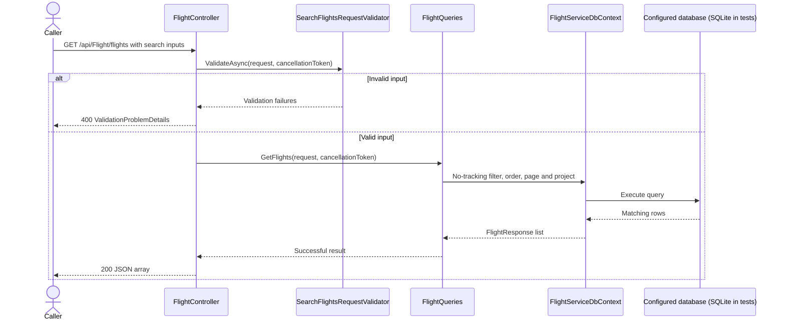

# Flight service

[Documentation index](../README.md) | [Architecture](../architecture.md)

## Runtime and API

[Program.cs](../../../backend/flight-service/Program.cs) chains per-layer
`AddApi`, `AddApplication`, and `AddInfrastructure` registration. It enables
exception handling, status-code pages, HTTPS redirection, authorization middleware,
controllers, and development-only OpenAPI at `/openapi/v1.json`.
No authentication scheme or authorization requirement is configured on these controllers.

| Method | Path | Current behavior |
| --- | --- | --- |
| GET | `/api/Flight/flights` | Validated, paginated flight search |
| GET | `/api/Flight/flight/{flightId}` | Single-flight query with positive integer ID |
| GET | `/api/Flight/flight/{flightId}/seat-map` | Current assigned aircraft's passenger layout; unassigned flight returns 409 |
| PUT | `/api/Flight/flight/{flightId}/aircraft` | Assign/reassign an active aircraft with an active, type-compatible configuration; 204 |
| POST | `/api/configurations` | Create a configuration with an empty map; 201 with `{ "id": ... }` and Location |
| GET | `/api/configurations/{configurationId}` | Configuration metadata and its passenger map |
| PUT | `/api/configurations/{configurationId}/active` | Set active state; 204 |
| PUT | `/api/configurations/{configurationId}/seat-map/rows/{rowNumber}` | Add/update a numbered row, replacing its complete position list; 204 |
| DELETE | `/api/configurations/{configurationId}/seat-map/rows/{rowNumber}` | Remove row and its positions; 204 |
| GET | `/api/Aircraft/aircrafts` | Placeholder: returns empty `200 OK`; does not query aircraft |
| GET | `/api/Aircraft/aircraft/{aircraftId}` | Placeholder: returns empty `200 OK` |

[AirportController](../../../backend/flight-service/Api/Controllers/AirportController.cs)
has no actions, so it exposes no airport query endpoint.

### Search and response contract

Search uses [SearchFlightsRequest](../../../backend/flight-service/Application/Contracts/Requests/SearchFlightsRequest.cs):

- `DepartureAirport` and `ArrivalAirport`: required exact uppercase three-letter
  IATA codes, without trimming or normalization.
- `DepartureDate`: required date, less than `DateOnly.MaxValue`.
- `Page`: defaults to 1 and must be positive.
- `PageSize`: defaults to 20 and must be 1 through 100.
- Pagination rejects offsets beyond the supported integer range.

Example: `GET /api/Flight/flights?DepartureAirport=WAW&ArrivalAirport=KRK&DepartureDate=2026-10-13&Page=1&PageSize=20`.

The response is a JSON array, not a pagination envelope.
[FlightResponse](../../../backend/flight-service/Application/Contracts/Responses/FlightResponse.cs)
contains `id`, `flightNumber`, `departureTime`, `arrivalTime`, `departureAirport`
and `arrivalAirport`. Time values are projected with explicit UTC offsets.
The single-flight endpoint returns one DTO of the same shape.

### Outcomes

- Search with no matches: `200` and an empty array.
- Invalid search or route input: `400` validation problem details.
- Missing single flight: `404` problem details with code `flight_not_found`.
- Unexpected failures: `500` safe problem details with a trace identifier; full
  exceptions are logged internally. Unrecognized query failures are not treated
  as successful responses.

## Query sequence

Queries call [IFlightQueries](../../../backend/flight-service/Application/Features/FlightFeatures/Queries/IFlightQueries.cs)
directly, not mediator handlers. Normal startup selects PostgreSQL;
the integration-test fixture replaces it with SQLite.



## Domain and persistence

### UI seat-map query and configuration management

[ConfigurationFeatures](../../../backend/flight-service/Application/Features/ConfigurationFeatures/)
groups configuration commands and direct layout queries.
[IConfigurationQueries](../../../backend/flight-service/Application/Features/ConfigurationFeatures/Queries/IConfigurationQueries.cs)
returns application DTO results, not entities or HTTP types. Both query endpoints
validate positive IDs at the API boundary; the query implementation also validates
IDs for non-HTTP callers. Reads are no-tracking, pass cancellation through EF,
and discover missing resources during the actual read.

The flight layout comes from `Flight -> Aircraft -> AircraftConfiguration -> SeatMap`
in a single database query. The response includes flight/aircraft IDs, registration,
configuration ID/code/version, and a nested `seatMap` with its ID and rows.
Rows contain their ID, positive number, cabin ID/name/code, descriptive type string,
and positions (`id`, `column`, `aisleGroup`, `isSeat`). Rows sort by number;
positions sort by aisle group then ordinal column. Empty layouts succeed with
empty rows. This is the **physical layout**, not bookings, seat availability,
or seating-service inventory.

Missing flights/configurations/aircraft/cabins return 404 with stable codes.
An existing flight without an assignment returns 409 with
`flight_aircraft_unassigned`. Assignment rejects inactive/maintenance/decommissioned
aircraft and inactive configurations with `aircraft_unavailable`, and rejects type
mismatches with `aircraft_configuration_mismatch`. Existing assignments stay
readable if a configuration is subsequently deactivated. Duplicate configuration
type/code/version returns 409 with `configuration_exists` when discovered before
creation; simultaneous conflicting writes are still protected by database unique
constraints and may surface as safe 500 errors. There is no optimistic concurrency
or schedule-overlap detection yet.

Commands run through DispatchR validation and transaction pipelines, with tracked
repositories and the scoped Unit of Work. Create configuration flushes the Unit
of Work inside that transaction to obtain its generated ID before returning;
the pipeline still owns commit/rollback. Other new handlers only mutate tracked
aggregates. Configuration rows use positive unique numbers; PUT updates cabin,
row types, and the entire position list. Matching ordinal column names retain
position IDs, absent columns are removed, and new columns receive new IDs.
Row type accepts names/flag combinations (`Seats`, `ExitRow`, `Bulkhead`, `Galley`,
`Lavatory`) or valid numeric masks 1..31. Columns must be nonblank, at most 16
characters, and ordinal-unique within the row; aisle groups must be nonnegative.
An empty position list is valid for service/non-seat rows.

Layouts are **shared and edited live**: changing a configuration affects every
aircraft/flight referencing it, with no published snapshot or version freeze.
Create a new configuration/version for an intentionally separate layout.
The management endpoints currently have **no authentication/authorization**.
They must be access-controlled before exposing them beyond trusted development.
Requests for each endpoint are in [flight-service.http](../../../backend/flight-service/flight-service.http).

The domain includes flights and ordered segments, schedules with operating days,
airports and gates, aircraft and types, and aircraft configurations with passenger
seat maps. Aggregate methods control child collection changes.

### Aircraft configuration and seat-map ownership

[`AircraftConfiguration`](../../../backend/flight-service/Domain/Entities/AircraftConfiguration.cs)
remains the aggregate root. Its factory creates one
[`SeatMap`](../../../backend/flight-service/Domain/Entities/SeatMap.cs) child entity;
maps have no independent creation workflow, version, or repository. Multiple
aircraft may reference the same configuration, but different configurations do not
share a seat map. Rows now reference a map rather than the configuration directly:

```text
Aircraft -> AircraftConfiguration -> SeatMap -> SeatMapRows -> SeatMapPositions
```

Create rows with `SeatMapRow.Create(configuration.SeatMap, cabin, rowType)` and
add them with `configuration.SeatMap.AddRow(row)`. The map exposes its rows as a
read-only collection and rejects duplicate additions and rows from another map.
Cabins remain referenced descriptive entities rather than children deleted with a map.
Load `SeatMap` and its rows/positions explicitly when editing the aggregate;
there is no automatic eager loading.

Domain ownership is mapped as a required one-to-one relationship in separate
`SeatMaps` storage, not EF `OwnsOne`. A unique configuration foreign key prevents
multiple maps for one configuration. Deleting an unreferenced configuration
cascades through its map, rows, and positions; referenced configurations still
cannot be deleted while aircraft use them.

This changes the schema: add `SeatMaps` with `AircraftConfigurationId`, and move
the row foreign key from `AircraftConfigurationId` to `SeatMapId`. No migrations
are currently supplied in the repository. Existing databases need a reviewed
migration that creates one map per configuration and backfills row references
before dropping the old foreign key/column; `EnsureCreated` does not upgrade them.
Assignment/layout management additionally requires nullable `Flights.AircraftId`
with a restricted-delete aircraft FK and index, and non-null `SeatMapRows.Number`
with a unique `(SeatMapId, Number)` index. Backfill existing row numbers with
explicitly reviewed display order per map (for example, deterministic ID order
only if it matches the real aircraft layout), then enforce non-null/uniqueness.
No schema upgrade or live database migration has been applied.
Cargo layouts, independent seat-map publishing, and new versioning rules remain
deferred.

### Schedule operating days

Schedule operating days use the `OperatingDays` value object with
`FromDays(IEnumerable<DayOfWeek>)` and `HasDay(DayOfWeek)`. Construction requires
at least one valid day; duplicates are collapsed. Persistence retains the existing
integer bitmask (Monday = 1 through Sunday = 64), not `DayOfWeek` enum numbers.
`FromValue` supports valid stored masks including the `None` sentinel; schedules
reject `None`. The schedule command accepts a typed day collection and validates
nonempty input and defined enum values.

The [Schedule](../../../backend/flight-service/Domain/Entities/Schedule.cs) aggregate
is exposed through `FlightServiceDbContext.Schedules`. Its EF mapping retains
the `FlightSchedules` table name for storage compatibility.
The create command, handler, and validator live under
[ScheduleFeatures/Commands/CreateSchedule](../../../backend/flight-service/Application/Features/ScheduleFeatures/Commands/CreateSchedule/).

### Queries and infrastructure

[FlightQueries](../../../backend/flight-service/Infrastructure/Persistence/Queries/FlightQueries.cs)
filters departure times using UTC day boundaries and orders by departure time
then ID before pagination. EF projections avoid serializing domain entities.
Single reads discover absence during the read and return `FlightNotFoundError`.

[FlightServiceDbContext](../../../backend/flight-service/Infrastructure/Persistence/FlightServiceDbContext.cs)
loads mappings from its persistence configuration namespace and maps MassTransit's
inbox/outbox tables. Normal startup selects PostgreSQL using
`ConnectionStrings:FlightDatabase` and registers RabbitMQ with an EF bus outbox.
See [development setup](../development.md#prerequisites-and-local-startup) for
required settings and schema prerequisites. No migrations or seed data are supplied.
An unconfigured database read produces a safe server error, not sample data.

## Commands, events and verification

Configuration/seat-map management and flight assignment handlers are wired through
the shared DispatchR pipelines. No concrete integration events, consumers, or
cross-service flows are currently wired.
The aircraft controller has an unused mediator constructor parameter, not an
implemented command/query path.

Configuration API tests exercise real HTTP routes, validators, mediator handlers,
transactions and SQLite persistence, including generated IDs/Location, row/position
reconciliation, cascade removal, reassignment, explicit errors, no-tracking reads,
cancellation, and OpenAPI metadata. They do not verify live PostgreSQL/RabbitMQ
delivery or concurrent management edits.

Tests cover input validation, aggregate collection ownership, EF relationships,
query ordering and UTC date boundaries, result mapping, safe exception responses
and OpenAPI response metadata. Infrastructure tests verify PostgreSQL model/schema
generation without opening a connection. Shared tests exercise domain-event
dispatch and outbox persistence/rollback without a live broker.
See [development checks](../development.md#verification).
