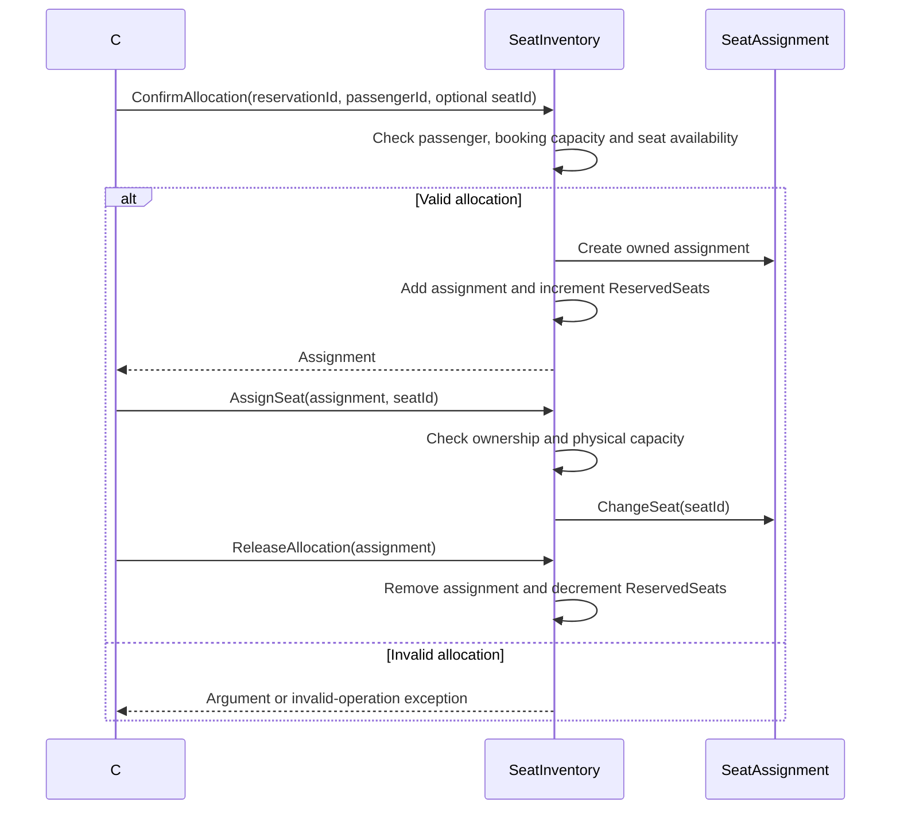

# Seating service

[Documentation index](../README.md) | [Architecture](../architecture.md)

## Implementation status

The host participates in booking's MassTransit workflow using Redis temporary
holds and PostgreSQL confirmed allocations. Holds consume cabin capacity and can
also name physical seats. There is no public anonymous inventory-management API.
See the [service README](../../../backend/seating-service/README.md) for provisioning,
configuration, consistency assumptions, and recovery procedures.

## Seat inventory and allocations

[SeatInventory](../../../backend/seating-service/Domain/Entities/SeatInventory.cs)
is an aggregate for a flight/cabin pair and owns its `SeatAssignment` collection.
Flight, cabin, reservation, passenger and seat references are opaque strings;
nonblank checks preserve their supplied representation.

| Quantity | Rule |
| --- | --- |
| `TotalSeats` | Positive physical capacity |
| `OverbookingAllowance` | Nonnegative; defaults to zero |
| `BookingLimit` | Total seats plus allowance, with overflow rejected during creation |
| `ReservedSeats` | Confirmed allocations, including those without a seat |
| `RemainingBookingCapacity` | Booking limit minus reserved seats |
| `OverbookedSeats` | Maximum of zero and reserved seats minus total seats |

- `ConfirmAllocation` rejects duplicate passenger IDs and exhausted booking
  capacity. An allocation may omit a seat ID.
- Named seats must be unique in the inventory. Assigned physical seats cannot
  exceed `TotalSeats`, even when booking capacity allows overbooking.
- `AssignSeat` and `ClearSeat` change a seat without changing reserved capacity.
- `ReleaseAllocation` removes an owned allocation and frees booking capacity.
- Operations reject allocations owned by another inventory.

## In-process allocation sequence

## Reservation workflow participant

The shared contracts expose hold, confirm, and release operations correlated by
workflow ID. Redis owns temporary hold validity, owner tokens, and expiration;
confirmed allocations remain authoritative in SQL. A durable operation ledger
supports idempotency and terminal cancellation without becoming a second
authoritative temporary-capacity counter.

Cross-store confirmation is not an atomic Redis/SQL transaction. SQL capacity and
physical-seat constraints must remain authoritative at confirmation, with Redis
cleanup after commit. Stale Redis holds may conservatively reduce availability;
they must never make SQL-confirmed seats available. Release must remain safe when
it arrives before a delayed hold or confirmation request.

Cabin-capacity reservation is separate from optional physical-seat assignment.
Booking does not need to select a seat to secure a cabin allocation.
Redis loss or unavailability must not silently fall back to granting holds.

Test sources cover domain and handler behavior. Live Redis/PostgreSQL checks
exist in the integration project but have not been run.

## Code structure

The service uses the same Api/Application/Domain/Infrastructure layering as the
flight service. Hold, confirm, release and post-commit cleanup are DispatchR
commands under `Application/Features/InventoryFeatures`; MassTransit consumers
in `Infrastructure/Integrations/Consumers` only send those commands. Because the
MassTransit consumer outbox owns the SQL transaction, the handlers are plain
commands and save once through the shared unit of work. `InventoryOperation`
(aggregate) owns the Held to Confirmed/Rejected/Released transitions and the
release fence. Repositories, the SQL mutation lock and the independent release
fence live in `Infrastructure/Repositories`; EF mappings are one configuration
class per entity. The `--initialize-database` bootstrap was removed: no
migrations are checked in, and schema plus inventory/seat provisioning are
prerequisites (see the service README).
