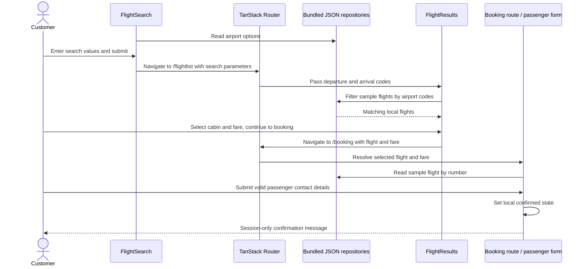

# Customer web application

[Documentation index](README.md) | [Architecture](architecture.md)

## Platform and routes

[polonia-web](../frontend/polonia-web/) uses React, TypeScript, TanStack Start
and file-based TanStack Router routes, Mantine components/forms, and Vite.
The root document supplies the application shell, theme initialization and devtools.
Desktop and native mobile applications are not present.

| Route | Current feature |
| --- | --- |
| `/` | Flight-search form |
| `/flightlist` | Locally filtered flight cards, cabin/fare selection and flight details |
| `/booking` | Selected flight/fare summary and passenger contact form |
| `/about` | Starter informational page |

## Data and behavior

[Airport repository](../frontend/polonia-web/src/entities/airport/airport.repository.ts)
loads bundled airport JSON for select options and code lookup.
[Flight repository](../frontend/polonia-web/src/features/flight-results/data/flight.repository.ts)
loads bundled sample flight JSON and filters only by departure and arrival airport.
There is no backend fetch/API client in the current route flow.

The search form collects airports, outbound/return dates, trip type and passenger
counts. Navigation includes airport/date/trip-type query parameters, but not
passenger counts. The result route passes only `from` and `to` into filtering;
dates and round-trip selection do not drive a real availability search.

Booking resolves the selected flight number and numeric fare ID from local data.
Missing selections show a "Choose a flight first" prompt.
The contact form validates first name, last name and email. Confirmation only
sets React component state: it does not persist a reservation, contact the booking
service, allocate a seat or process payment.

## Search-to-confirmation sequence

This is deliberately separate from the backend query and domain sequences.
Connecting it to real availability, booking and payment requires new implementation.

## Development

See [development commands](development.md). Existing responsive styles and
light/dark/automatic theme behavior are present in the source; this documentation
baseline does not claim browser/device testing or accessibility certification.
