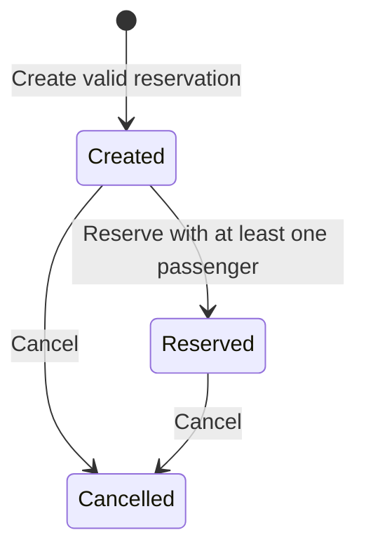
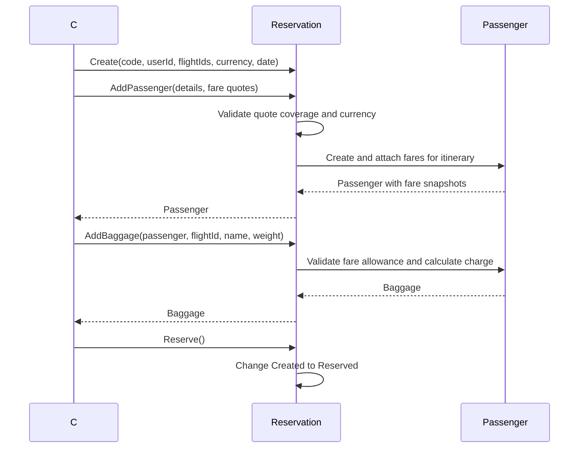

# Booking service

[Documentation index](../README.md) | [Architecture](../architecture.md)

## Implementation status

[Program.cs](../../backend/booking-service/Program.cs) still runs the ASP.NET
weather scaffold: `GET /weatherforecast` returns five generated forecasts.
OpenAPI is mapped in development, and HTTPS redirection is enabled.
The reservation controller source file is empty. There is no booking business
endpoint, command handler, query service, persistence registration or payment-provider integration.

The domain below is usable through C# methods and exercised by unit tests; it is
not connected to the web application's booking confirmation.

## Reservation aggregate

[Reservation](../../backend/booking-service/Domain/Entities/Reservation.cs) owns
ordered itinerary entries, passengers and payments.

- Creation requires a code, positive service-owned user ID, reservation date and
  a nonempty itinerary of distinct nonblank flight IDs.
- External flight IDs retain their representation and use ordinal, case-sensitive
  uniqueness. The reservation code is trimmed and currency follows currency-code validation.
- Each passenger requires exactly one fare quote per itinerary flight with the
  reservation currency. Quotes snapshot product, cabin, amount and baggage allowance.
- Passenger dates cannot be missing or after the reservation date.
- Baggage belongs to a passenger's fare for a specific flight. Allowances govern
  included pieces, extra pieces, per-piece weight limits and extra-piece charges.
- Total amount is derived from passenger fares and baggage charges.
- Recorded payments require positive amounts, matching currency, unique references
  and cannot exceed the current reservation total. Recording a payment is not
  payment authorization or capture.

### State transitions

Passengers and baggage can be edited only while the reservation is `Created`.
Reservation requires at least one passenger. Cancellation is allowed from
`Created` or `Reserved`; cancelling an already cancelled reservation fails.
Payments can be recorded while created or reserved, but not cancelled.

## Local domain flow

This is an in-process sequence, not an HTTP or cross-service booking workflow.

## References and gaps

Other domain types include `ReservationFlight`, `Passenger`, `PassengerFare`,
`Baggage`, `Payment`, `User`, `FareQuote`, `BaggageAllowance` and `ReservationStatus`.
Foreign service IDs are references only; they do not query the flight or seating service.
There are no published reservation integration events or consumers.

Unit tests cover itineraries, identifier preservation, collection ownership,
per-passenger/per-flight fares and baggage, state changes and payments.
The booking integration-test project has no test source files.
