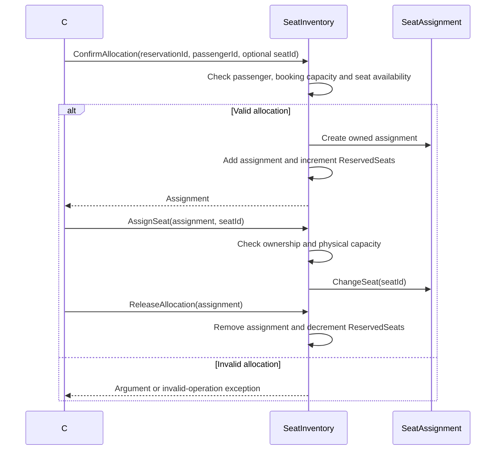

# Seating service

[Documentation index](../README.md) | [Architecture](../architecture.md)

## Implementation status

[Program.cs](../../backend/seating-service/Program.cs) exposes only the generated
`GET /weatherforecast` scaffold, development OpenAPI and HTTPS redirection.
There are no seating business endpoints, command/query handlers, database
registration, consumers or service-to-service calls.

## Seat inventory and allocations

[SeatInventory](../../backend/seating-service/Domain/Entities/SeatInventory.cs)
is an aggregate for a flight/cabin pair and owns its `SeatAssignment` collection.
Flight, cabin, reservation, passenger and seat references are opaque strings;
nonblank checks preserve their supplied representation.

| Quantity | Rule |
| --- | --- |
| `TotalSeats` | Positive physical capacity |
| `OverbookingAllowance` | Nonnegative; defaults to zero |
| `BookingLimit` | Total seats plus allowance, with overflow rejected during creation |
| `ReservedSeats` | Confirmed allocations, including those without a seat |
| `RemainingBookingCapacity` | Booking limit minus reserved seats |
| `OverbookedSeats` | Maximum of zero and reserved seats minus total seats |

- `ConfirmAllocation` rejects duplicate passenger IDs and exhausted booking
  capacity. An allocation may omit a seat ID.
- Named seats must be unique in the inventory. Assigned physical seats cannot
  exceed `TotalSeats`, even when booking capacity allows overbooking.
- `AssignSeat` and `ClearSeat` change a seat without changing reserved capacity.
- `ReleaseAllocation` removes an owned allocation and frees booking capacity.
- Operations reject allocations owned by another inventory.

## In-process allocation sequence

No allocation event is emitted, and no booking-service integration is present.
Unit tests cover capacities, overbooking, seat changes, ownership, invalid inputs
and identifier preservation. The seating integration-test project has no test source files.
